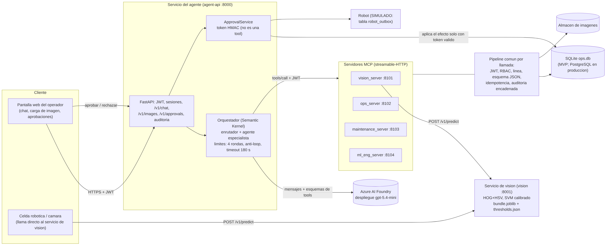
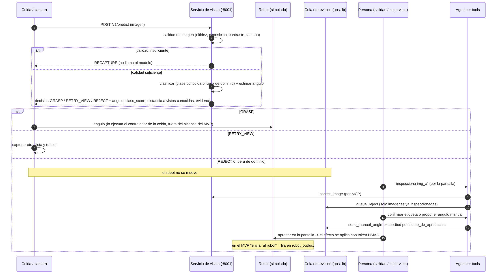
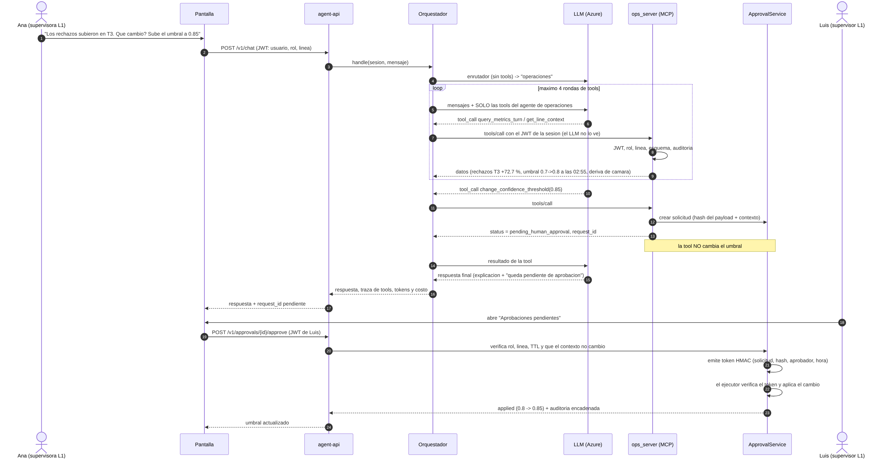

# Arquitectura del MVP (Reto 4)

Este documento describe **lo que está implementado y probado en este repositorio**, y separa con claridad lo que es simulación del MVP y lo que sería distinto en producción. Los números de calidad del modelo vienen del Reto 2 (protocolo A); los resultados del asistente con el LLM real salen de `eval/run_eval.py` y no están en este documento.

## 1. Vista de componentes



| Componente | Qué es | Código | Puerto |
|---|---|---|---|
| Servicio de visión | API independiente: calidad de imagen → clasificación (clase conocida o fuera de dominio) → ángulo → decisión `GRASP` / `RETRY_VIEW` / `REJECT`. Carga el artefacto versionado al arrancar. | `services/vision_api/` | 8001 |
| Artefacto de modelo | `models/protocolo_A/bundle.joblib` + `thresholds.json` (versión `A-26635cc67c13`). HOG + color HSV, SVM-RBF calibrado. | `src/export_model.py` | — |
| Servidores MCP (4) | Las 15 tools, agrupadas por dominio: visión, operaciones, mantenimiento, ingeniería ML. Todas pasan por el mismo pipeline (JWT → rol → línea → esquema → idempotencia → auditoría). | `services/mcp_servers/`, `services/common/toolkit.py` | 8101–8104 |
| Orquestador | Enrutador (una llamada al LLM sin tools) + agente especialista con solo sus tools. Límites aplicados **por código**: 4 rondas de tools, un segundo intento idéntico corta (`loop_detected`), timeout de 180 s, historial de 5 turnos. Cliente LLM con Semantic Kernel. | `services/agent/` | — |
| API del agente + pantalla | Login demo, carga de imágenes, chat, aprobaciones, verificación de la auditoría, `/health`. | `services/agent_api/` | 8000 |
| Servicio de aprobaciones | Emite el token HMAC y ejecuta el efecto. **No es una tool MCP**: el LLM no puede invocarlo ni ver el token. | `services/common/approvals.py`, `effects.py` | (dentro de agent-api) |
| Datos | SQLite (`ops.db`) y almacén de imágenes. | `services/common/db.py` | — |

**Separación de responsabilidades**: el servicio de visión no conoce al agente. La celda robótica puede llamarlo directamente en el lazo en tiempo real; el agente se usa para operación, revisión y gestión, no para decidir cada pieza.

## 2. Secuencia 1: de la imagen al robot



Puntos a tener en cuenta:

* La decisión automática (`GRASP`) la toma el servicio de visión con sus umbrales; el asistente no está en ese camino.
* El controlador de la celda que ejecuta el ángulo **no forma parte del MVP**. El robot se simula con la tabla `robot_outbox`: "enviar al robot" significa insertar una fila, solo después de una aprobación humana.
* Para casos `REJECT` o fuera de dominio, el camino asistido es: `inspect_image` → `queue_reject` → revisión humana → `send_manual_angle` (queda pendiente) → aprobación → efecto.
* La imagen no viaja al LLM. El agente solo maneja identificadores (`img_…`) y los resultados numéricos de las tools.

## 3. Secuencia 2: flujo agéntico con aprobación humana



Los datos del ejemplo (rechazos T3 +72,7 %, umbral 0,7→0,8 a las 02:55, deriva de cámara) son **datos simulados** sembrados por `scripts/seed_demo.py`, no mediciones de una planta.

Garantías que el código impone, independientes de lo que el LLM decida:

1. La identidad (`user`, `role`, `line`) sale del JWT, nunca de los argumentos. Un `line_id` distinto responde `FORBIDDEN_LINE`.
2. Cada agente solo ve sus tools; una tool fuera de su conjunto responde `UNKNOWN_TOOL`.
3. Las 3 tools de riesgo operativo y la promoción de modelo **solo crean una solicitud** (`pending_human_approval`). El efecto lo aplica `ApprovalService.approve`, que exige: rol autorizado, misma línea, TTL vigente, que el contexto (umbral, estado, versión) no haya cambiado desde la solicitud y, para la promoción, un aprobador distinto del solicitante.
4. Toda llamada queda en una auditoría con cadena de hashes verificable (`GET /v1/audit/verify`).

## 4. Despliegue

Un comando desde la raíz, con la configuración en `.env` (plantilla: `.env.example`; ningún valor está en el código ni en las imágenes):

```
python scripts/init_env.py        # crea .env con secretos aleatorios; completar AZURE_OPENAI_*
docker compose up --build         # http://localhost:8000
```

Sin Docker: `python scripts/run_stack.py` levanta los mismos 6 procesos. `python scripts/smoke_stack.py` comprueba el stack en marcha.

| Servicio compose | Imagen | Notas |
|---|---|---|
| `vision` | `deploy/Dockerfile.vision` (mínima) | salud en `/health`, modelo cargado al arrancar |
| `bootstrap` | `deploy/Dockerfile.agent` | una vez: siembra datos si faltan |
| `mcp-vision`, `mcp-ops`, `mcp-maintenance`, `mcp-ml` | `deploy/Dockerfile.agent` | MCP por HTTP, JWT en `Authorization: Bearer` |
| `agent-api` | `deploy/Dockerfile.agent` | espera a que los 4 MCP estén sanos |

Los datos viven en un **volumen nombrado** (`appdata`), no en una carpeta de Windows: SQLite en modo WAL necesita memoria compartida real entre contenedores.

Reproducibilidad: dependencias con versión fijada (`requirements-*.txt`), artefacto de modelo versionado (`version` en `thresholds.json`), datos simulados con semilla fija, y contratos generados del código (`scripts/export_contracts.py`, con prueba que falla si se desfasan).

## 5. Configuración

Todo por variables de entorno (ver `.env.example`): LLM (`AZURE_OPENAI_*`, `PRICING_MODEL_KEY`, `LLM_TEMPERATURE`), límites (`MAX_AGENT_ITERATIONS`), visión (`VISION_*`), seguridad (`JWT_SECRET`, `APPROVAL_SECRET`, `APPROVAL_TTL_MINUTES`), reglas de negocio (`PROMOTION_MIN_*`, `SKU_*`) y despliegue (`AGENT_HUB`, `AGENT_MODE`, `AUTH_MODE`, `MCP_*`).

## 6. Limitaciones del MVP (lo que no es producción)

| Tema | MVP | Producción (propuesta) |
|---|---|---|
| Datos | SQLite en volumen compartido; datos de operación **simulados** | PostgreSQL gestionado; integración con MES/SCADA |
| Sesiones del agente | En memoria del proceso (se pierden al reiniciar; una sola réplica) | Redis |
| Identidad | `AUTH_MODE=demo` emite JWT para usuarios de ejemplo | SSO corporativo (Entra ID); `AUTH_MODE` distinto de `demo` apaga el endpoint |
| Transporte | HTTP sin TLS | Terminación TLS en el balanceador / API gateway |
| Robot | Simulado (`robot_outbox`) | Controlador de la celda con confirmación de ejecución |
| Promoción de modelo | Actualiza el registro de versiones; **el servicio de visión no recarga el artefacto automáticamente** | Despliegue gradual con rollback automático |
| Recuperación de SOP | TF-IDF sobre un corpus pequeño, no una base vectorial | Búsqueda vectorial + control de versiones de documentos |
| `test_sku_model` | Evaluación **simulada** para los SKU de demostración | Reentrenamiento real en un pipeline de MLOps |
| Cuotas y límites de tasa | Solo límites por solicitud (4 rondas, 2000 caracteres, 180 s) | Cuota por usuario/turno y alertas de costo |
| Calidad del modelo | Cobertura de prueba del 45,2 % de las imágenes en el Reto 2 (una sola partición) | Validación con imágenes reales de planta |
